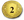
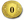
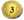

# Dominion auf Steam / Dominion on Steam

[Deutsch](#dominion-auf-steam-ohne-mods) | [English](#dominion-on-steam-without-mods)

**Inhaltsverzeichnis / Contents**

- **Deutsch:** [Königreich speichern und teilen](#königreich-speichern-und-teilen) · [Kampagneneffekte eingeben](#kampagneneffekte-eingeben) · [Effektkatalog](#katalog-der-kampagneneffekte) · [F8-Effektdialog](#f8-effektdialog-mit-dem-lokalen-patch)
- **English:** [Save and share a Kingdom](#save-and-share-a-kingdom) · [Enter campaign effects](#enter-campaign-effects) · [Effect catalog](#campaign-effect-catalog)

## Dominion auf Steam ohne Mods

### Königreich speichern und teilen

1. Öffne die Königreich-Auswahl einer benutzerdefinierten Partie und wähle die Stapel.
2. Klicke in der laufenden Partie mit der rechten Maustaste auf das Burgsymbol unten rechts. Speichere das Königreich als Set oder kopiere es in die Zwischenablage.
3. Lade ein gespeichertes Set in der Königreich-Auswahl oder füge den kopierten Text dort ins Kartensuchfeld ein. [Zwischenablage und Spielbefund](Kingdom_Sets.md#zwischenablage)

Für einen Zufallsplatz aus einer bestimmten Erweiterung suche nach ihrem Namen und wähle den passenden Zufallseintrag. [Community-FAQ](https://www.reddit.com/r/dominion/comments/1ahhoec/dominion_app_faq/)

### Kampagneneffekte eingeben

#### Ein Dorfstapel mit 20 Karten

Füge diese Zeile ins Kartensuchfeld einer neuen lokalen Partie ein. Im Spieltest mit Build 3315 startete Dorf mit 20 Karten.

```text
-k cellar, market, merchant, militia, mine, moat, remodel, smithy, village, workshop -x start_double_pile(village)
```

Hinter `-k` stehen die IDs der Karten und Landschaften. Hinter `-x` kannst du den Beispielbefehl durch einen Effekt aus dem Katalog ersetzen. Setze für Platzhalter wie `Karten-ID` die Ziel-ID ein. Zielkarten und Landschaften für Stempel müssen in der Partie vorkommen. Trenne mehrere Effekte durch Kommas in einem einzigen `-x`-Abschnitt. [Deutsche Kartentitel und IDs](Card_Titles_de.json)

Das Suchfeld übernimmt jeden Effektbefehl nur einmal, auch bei verschiedenen Zielen. Für mehrere `start_double_pile`-Einträge verwende ein gespeichertes Set. [Befund zum Suchfeld](Modding_Overview.md#warum-das-suchfeld-nur-einen-stapel-verdoppelt)

#### Mehrere Stapel über ein gespeichertes Set verdoppeln

Bereite ein Set mit den gewünschten Verdopplungen vor. Verwende höchstens **32 Effekte** pro Liste. Ab dem 33. Eintrag bricht Build 3315 beim Laden ab. [Effektset vorbereiten](../SetGenerator/README.md#html-konverter-mit-doppelten-stapeln), [Befund zur Grenze](Modding_Overview.md#effektsets-und-zufallsauswahl)

1. Lade das Effektset und klicke auf **Spielen**.
2. Gib die Partie auf und entlade das Set in der Königreich-Auswahl. Lass die Zusatzregeln stehen. Ihr Marker bleibt sichtbar.
3. Lade dasselbe Set erneut oder wähle ein separates Set mit dem gewünschten Königreich. Klicke auf **Spielen**. [Lokal bestätigter Ablauf](Modding_Overview.md#warum-die-effekte-beim-set-wechsel-hinterherhinken)

#### Zufällige Königreiche mit doppelten Stapeln

Ein Set mit ausschließlich `-x` lässt das Spiel das Königreich auswürfeln. Passt der ganze Zufallspool in die Liste, nimm pro möglichem Ziel einen Eintrag aus der Nachschlageliste. Bei größeren Pools ziehe zuerst die zehn Stapel und erstelle das Effektset für diese Auswahl. Verdoppelt werden nur Stapel, die beim Aufbau vorhanden sind. [Nachschlageliste](Start_Double_Pile_Karten.txt), [Spielbefund](Modding_Overview.md#effektsets-und-zufallsauswahl)

#### Zwölf oder mehr Königreichstapel

Im lokalen Test blieb das gespeicherte Set mit `twist_room_for_more(chapel)` bei zehn Stapeln. Die achte Füllhorn-Mission sieht in ihrer Vorlage zwölf Königreichstapel im Vorrat vor. Zu den zehn Hauptstapeln kommen Vorbote als Bann der Jungen Hexe und Gärten durch „Platz für Mehr“. Der Effekt hat einen Zielslot. Ein eigener Import mit mehr als zehn frei gewählten Stapeln und eine Grenze von 13 sind offen. [Spieltest und Kampagnenvorlage](Modding_Overview.md#zusatzstapel-durch-platz-für-mehr)

### Katalog der Kampagneneffekte

Die Tabellen erfassen 89 Befehle und sechs Varianten der Kampagnenerzeugung in Spielbuild **3315** (Steam-Build **17683350**). Namen und Regelbegriffe stammen aus den deutschen Spieltexten. Die Beschreibungen fassen die Kampagnenwirkung zusammen. Im privaten Online-Spiel fehlten die beiden getesteten Verdopplungen in der gestarteten Partie. [Online-Befund](Modding_Overview.md#kampagneneffekte-im-privaten-online-spiel), [Technischer Effektkatalog](Modding_Overview.md#belegstand-des-effektkatalogs), [Lokale Spieltexte](Sources/Source_Register.md#deutsche-kartentitel-aus-l05)

+ erhöht dein Kaufbudget für diesen Zug um 1. Einen Taler kannst du auch in einem späteren Zug ausgeben.

Die Angaben **Einmal** und **Mehrfach** in der Wirkungszelle beziehen sich auf gemessene lokale Partien in Build 3315. **Bis 3×** heißt, dass jede Kopie bis zur dritten eine zusätzliche Wirkung zeigte. **Gleiche Wirkung** heißt, dass zwei und drei Kopien denselben Messwert wie eine Kopie lieferten. **Offen** steht für eine ausstehende oder unvollständige Prüfung. [Messwerte](../KingdomEffectsPatch/TEST.md#automatisierte-lokale-effektprüfung-im-hintergrund)

**Wann/wie** beschreibt die vorgesehenen Auslöser und Ziele anhand der Spieltexte und dokumentierten Befunde. Offene Bedingungen sind ausdrücklich vermerkt. Der gemessene Prüfstand steht weiterhin bei **Einmal** und **Mehrfach**.

#### Alle 27 Spielvariationen mit `twist_`

Eine **Nicht-Vorrats-Kopie** ist ein zusätzliches Exemplar der Karte, das du von außerhalb des Vorrats nimmst.

| Name im Spiel | Befehl | Wirkung | Wann/wie |
| --- | --- | --- | --- |
| Große Ideen | `twist_big_ideas` | Zu Beginn deines Zuges **+1 Karte**. *Einmal – Ja · Mehrfach – Bis 3×* | Bei deinem Zugbeginn. |
| Gut beschäftigt | `twist_busy_busy` | Zu Beginn deines Zuges **+1 Aktion**. *Einmal – Ja · Mehrfach – Bis 3×* | Bei deinem Zugbeginn. |
| Das gewisse Etwas | `twist_extra_oomph` | Zu Beginn deines Zuges +. *Einmal – Ja · Mehrfach – Bis 3×* | Bei deinem Zugbeginn. |
| Für immer Verbündet | `twist_forever_favored` | Zu Beginn deines Zuges **+1 Gefallen**. *Einmal – Ja · Mehrfach – Bis 3×* | Bei deinem Zugbeginn. |
| Müllhaufen | `twist_garbage_heap` | Zu Beginn deines Zuges darfst du eine Handkarte entsorgen. *Einmal – Offen · Mehrfach – Offen* | Bei deinem Zugbeginn. |
| Penny-Party | `twist_penny_party` | Nimm zu Beginn deines Zuges ein Kupfer. *Einmal – Ja · Mehrfach – Bis 3×* | Bei deinem Zugbeginn. |
| Kauflaune | `twist_shoppers` | Zu Beginn deines Zuges **+1 Kauf**. *Einmal – Ja · Mehrfach – Bis 3×* | Bei deinem Zugbeginn. |
| Eingepfercht | `twist_cramped` | Du ziehst deine normale Hand mit 4 statt 5 Karten. *Einmal – Ja · Mehrfach – Bis 3×* | Beim Ziehen der normalen neuen Hand. |
| Vom Thron | `twist_from_the_throne` | Die erste Aktionskarte, die du pro Zug spielst, wird automatisch zweimal gespielt. *Einmal – Offen · Mehrfach – Offen* | Beim Ausspielen deiner ersten Aktionskarte pro Zug. |
| Deponie | `twist_landfill` | Wenn du eine deiner Karten entsorgst, **+1 Karte**. Das gilt auch für Karten, die du von einem anderen Ort als deiner Hand entsorgst. *Einmal – Offen · Mehrfach – Offen* | Beim Entsorgen einer eigenen Karte, unabhängig von ihrem Ort. |
| So viel Zeugs | `twist_so_much_stuff` | Wenn du deine erste Karte in einem Zug spielst, nimm eine Nicht-Vorrats-Kopie dieser Karte. *Einmal – Offen · Mehrfach – Offen* | Beim Ausspielen deiner ersten Karte pro Zug. |
| Verdopplung | `twist_double_up` | Wenn du in einem Zug zum ersten Mal eine Aktions- oder Geldkarte nimmst, nimm zusätzlich eine Nicht-Vorrats-Kopie dieser Karte. *Einmal – Ja · Mehrfach – Bis 3×* | Beim ersten Nehmen einer Aktions- oder Geldkarte pro Zug. |
| Überholspur | `twist_fast_track` | Wenn du eine Dauer- oder Reservekarte nimmst, lege sie zur Seite und spiele sie zu Beginn der kommenden Aufräumphase. *Einmal – Beiseitelegen bestätigt · Mehrfach – Bei 2× und 3× auf der Ablage* | Beim Nehmen einer Dauer- oder Reservekarte, dann zu Beginn der kommenden Aufräumphase. Späteres Ausspielen offen. |
| Grundbesitzer Verbündet | `twist_favored_landlords` | Wenn du eine Punktekarte nimmst, **+1 Gefallen**. *Einmal – Ja · Mehrfach – Bis 3×* | Beim Nehmen einer Punktekarte. |
| Reich Verbündet | `twist_favored_wealthy` | Wenn du eine Geldkarte nimmst, **+1 Gefallen**. *Einmal – Ja · Mehrfach – Bis 3×* | Beim Nehmen einer Geldkarte. |
| Auf dem Weg | `twist_incoming` | Wenn du eine Aktions- oder Geldkarte nimmst, kommt sie sofort oben auf deinen Nachziehstapel statt auf den Ablagestapel. *Einmal – Ja · Mehrfach – Gleiche Wirkung* | Beim Nehmen einer Aktions- oder Geldkarte. |
| Bonusauszahlung | `twist_rebates` | Wenn du eine Karte nimmst, +. *Einmal – Ja · Mehrfach – Bis 3×* | Beim Nehmen einer Karte. |
| Bechergläser | `twist_beakers` | Ungenutztes Trank-Guthaben bleibt erhalten, bis du es ausgibst. Du kannst es wie Taler in späteren Zügen zum Bezahlen verwenden. *Einmal – Offen · Mehrfach – Offen* | Beim Aufbewahren und späteren Bezahlen mit ungenutztem Trank-Guthaben. |
| Verzögertes Glück | `twist_delayed_joy` | Du darfst jede Gabe aufbewahren und erst im nächsten Zug ausführen. *Einmal – Offen · Mehrfach – Offen* | Beim Erhalten einer Gabe wählbar, Ausführung im nächsten Zug. |
| Gesparte Pennys | `twist_pennies_saved` | Am Ende deiner Kaufphase wird übriges Geld zu Talern. *Einmal – Offen · Mehrfach – Offen* | Am Ende deiner Kaufphase. |
| Großeigentümer | `twist_real_estate_barons` | Du kannst Siegpunktmarker als Taler ausgeben. *Einmal – Offen · Mehrfach – Offen* | Beim Bezahlen mit Siegpunktmarkern. |
| Alles muss raus | `twist_sale` | Karten kosten  weniger. *Einmal – Ja · Mehrfach – Bis 3×* | Dauerhaft bei der Ermittlung von Kartenkosten. |
| Vorsprung | `twist_head_start` | In der Kampagne erhältst du zu Beginn 2 Extrazüge. Die KI erhält 10 Siegpunktmarker. *Einmal – Offen · Mehrfach – Offen* | Zu Beginn der Kampagnenpartie. Lokale Übernahme der Kampagnenbedingungen offen. |
| Gespiegelte Kostbarkeiten | `twist_mirror_loot` | Der Kostbarkeiten-Stapel besteht aus Exemplaren derselben Kostbarkeit. *Einmal – Ja · Mehrfach – Gleiche Wirkung* | Beim Spielaufbau am Kostbarkeiten-Stapel. |
| Platz für Mehr | `twist_room_for_more(Stapel-ID)` | Legt beim Spielaufbau den gewählten Königreichkarten-Stapel in den Vorrat. Die [Übernahme aus einem eigenen Set](#zwölf-oder-mehr-königreichstapel) ist offen. *Einmal – Ja · Mehrfach – Einmal im F8-Editor* | Beim Spielaufbau am gewählten Königreichstapel. Übernahme aus eigenen Sets offen. |
| Rotationskoller | `twist_turn_turn_turn` | Zu Beginn jedes menschlichen Zuges nach dem ersten wandert bei jedem rotierbaren Vorratsstapel die oberste Gruppe gleicher Karten unter den Stapel. *Einmal – Offen · Mehrfach – Offen* | Zu Beginn jedes menschlichen Zuges nach dem ersten. Lokale Kampagnenbedingungen offen. |
| Taifun | `twist_typhoon(Stapel-ID,Stapel-ID,…)` | Zu Beginn der menschlichen Züge wird ein Königreichkarten-Stapel im Vorrat durch einen anderen ersetzt. Die Liste in Klammern legt die möglichen Ersatzstapel fest und fasst bis zu 20 Stapel-IDs. *Einmal – Offen · Mehrfach – Offen* | Zu Beginn menschlicher Züge. Bis zu 20 Ersatzstapel geordnet wählen. Späterer Wechsel offen. |

#### Alle 34 Stempel mit `stamp_`

| Name im Spiel | Befehl | Wirkung | Wann/wie |
| --- | --- | --- | --- |
| Plus Aktion | `stamp_plus_action(Karten-ID)` | Wenn du eine Karte von diesem Stapel spielst, **+1 Aktion**. *Einmal – Offen · Mehrfach – Offen* | Beim Ausspielen einer Karte vom gewählten Stapel. |
| Plus Karte | `stamp_plus_card(Karten-ID)` | Wenn du eine Karte von diesem Stapel spielst, **+1 Karte**. *Einmal – Offen · Mehrfach – Offen* | Beim Ausspielen einer Karte vom gewählten Stapel. |
| Plus Kauf | `stamp_plus_buy(Karten-ID)` | Wenn du eine Karte von diesem Stapel spielst, **+1 Kauf**. *Einmal – Offen · Mehrfach – Offen* | Beim Ausspielen einer Karte vom gewählten Stapel. |
| Plus Geld | `stamp_plus_coin(Karten-ID)` | Wenn du eine Karte von diesem Stapel spielst, +. *Einmal – Offen · Mehrfach – Offen* | Beim Ausspielen einer Karte vom gewählten Stapel. |
| Chamäleon | `stamp_chameleonize(Karten-ID)` | Beim Ausspielen werden **+Karten** und Geldboni in gleicher Höhe getauscht. Aus **+2 Karten** wird zum Beispiel + und umgekehrt. *Einmal – Offen · Mehrfach – Offen* | Beim Ausspielen einer Karte vom gewählten Stapel. |
| Vergünstigt | `stamp_discounted(Karten-ID)` | Die Karte kostet  weniger. *Einmal – Ja · Mehrfach – Bis 3×* | Dauerhaft bei der Kostenermittlung der gewählten Karte. |
| Später Zahlbar | `stamp_pay_later(Karten-ID)` | Der Geldpreis der Karte wird in gleich viele Schulden umgewandelt. *Einmal – Ja · Mehrfach – Gleiche Wirkung* | Dauerhaft bei der Kostenermittlung der gewählten Karte. |
| 2 zum Preis von 1 | `stamp_two_for_one(Karten-ID)` | Die Karte kostet  mehr. Wenn du sie nimmst, nimm zusätzlich eine Nicht-Vorrats-Kopie. *Einmal – Ja · Mehrfach – Bis 3×* | Bei der Kostenermittlung und beim Nehmen der gewählten Karte. |
| Einblick Bietend | `stamp_offers_insight(Karten-ID)` | Wenn du diese Karte nimmst, **+1 Karte** am Ende des Zuges. *Einmal – Offen · Mehrfach – Offen* | Beim Nehmen der gewählten Karte, Kartenbonus am Zugende. |
| Pferd Dazu | `stamp_with_horse(Karten-ID)` | Wenn du diese Karte nimmst, nimm ein Pferd. *Einmal – Ja · Mehrfach – Bis 3×* | Beim Nehmen der gewählten Karte. |
| Beute Dazu | `stamp_with_spoils(Karten-ID)` | Wenn du diese Karte nimmst, nimm eine Beute (`spoils`). *Einmal – Ja · Mehrfach – Bis 3×* | Beim Nehmen der gewählten Karte. |
| Dorfbewohner Dazu | `stamp_with_villager(Karten-ID)` | Wenn du diese Karte nimmst, **+1 Dorfbewohner**. *Einmal – Ja · Mehrfach – Bis 3×* | Beim Nehmen der gewählten Karte. |
| Zusatztyp Dauerkarte | `stamp_durationified(Karten-ID)` | Die Karte wird zusätzlich zur Dauerkarte. Wenn du sie spielst, gibt sie dir zu Beginn deines nächsten Zuges **+1 Karte** und **+1 Aktion**. *Einmal – Zusatztyp bestätigt · Mehrfach – Gleicher Zusatztyp* | Zusatztyp dauerhaft. Nach dem Ausspielen der gewählten Karte Bonus zum nächsten eigenen Zugbeginn. |
| Zusatztyp Geldkarte | `stamp_treasurified(Karten-ID)` | Die Karte hat zusätzlich den Typ Geld. Du kannst sie dadurch auch als Geldkarte in der Kaufphase spielen. *Einmal – Zusatztyp bestätigt · Mehrfach – Gleicher Zusatztyp* | Zusatztyp dauerhaft. Gewählte Karte in der Kaufphase als Geldkarte spielbar. |
| Zusatztyp Punktekarte | `stamp_victorified(Karten-ID)` | Die Karte wird zusätzlich zur Punktekarte und ist  wert. *Einmal – Zusatztyp bestätigt · Mehrfach – Gleicher Zusatztyp* | Zusatztyp dauerhaft, Siegpunkt bei der Wertung der gewählten Karte. |
| Zusatztyp Reaktion | `stamp_reactionified(Karten-ID)` | Die Karte wird zusätzlich zur Reaktion. Du darfst sie spielen, wenn du sie außerhalb der Aufräumphase nimmst, entsorgst oder ablegst. *Einmal – Zusatztyp bestätigt · Mehrfach – Gleicher Zusatztyp* | Beim Nehmen, Entsorgen oder Ablegen der gewählten Karte außerhalb der Aufräumphase. |
| Zusatztyp Schatten | `stamp_shadowified(Karten-ID)` | Die Karte wird zusätzlich zur Schattenkarte. Du kannst sie aus deinem Nachziehstapel spielen, als wäre sie in deiner Hand. Wenn sie eingemischt wird, kommt sie unter den Nachziehstapel. *Einmal – Zusatztyp bestätigt · Mehrfach – Gleicher Zusatztyp* | Beim Einmischen und beim Ausspielen der gewählten Karte aus dem Nachziehstapel. |
| −2 Kosten | `stamp_cost_2_less(Ereignis-ID)` | Das Ereignis kostet  weniger. *Einmal – Ja · Mehrfach – Bis 3×* | Bei der Kostenermittlung des gewählten Ereignisses. |
| −2 Schuldenkosten | `stamp_cost_2D_less(Ereignis-ID)` | Das Ereignis kostet 2 Schulden weniger. *Einmal – Startabbruch mit Triumph · Mehrfach – Startabbruch mit Triumph* | Bei der Kostenermittlung des gewählten Ereignisses. In Build 3315 wegen Startabbrüchen gesperrt. |
| Kostenlos | `stamp_cost_zero(Ereignis-ID)` | Das Ereignis kostet . *Einmal – Ja · Mehrfach – Gleiche Wirkung* | Bei der Kostenermittlung des gewählten Ereignisses. |
| Extrageld | `stamp_bonus_money(Ereignis-ID)` | Wenn du das Ereignis kaufst, +. *Einmal – Ja · Mehrfach – Bis 3×* | Beim Kaufen des gewählten Ereignisses. |
| Silber Dazu | `stamp_also_silver(Ereignis-ID)` | Wenn du das Ereignis kaufst, nimm ein Silber. *Einmal – Ja · Mehrfach – Gleiche Wirkung* | Beim Kaufen des gewählten Ereignisses. |
| Neue Impulse | `stamp_motivational(Ereignis-ID)` | Wenn du das Ereignis kaufst, **+2 Karten** am Ende des Zuges. *Einmal – Offen · Mehrfach – Offen* | Beim Kaufen des gewählten Ereignisses, Kartenbonus am Zugende. |
| Hab's Bereits | `stamp_got_it_already(Ereignis-ID)` | Das Ereignis wird in deinem ersten Zug automatisch und kostenlos gekauft. *Einmal – Ja · Mehrfach – Bis 3×* | Automatischer Kauf des gewählten Ereignisses im ersten Zug. |
| Tunnelblick | `stamp_one_track_mind(Ereignis-ID)` | Das Ereignis wird zu Beginn jeder Kaufphase automatisch und kostenlos gekauft. *Einmal – Offen · Mehrfach – Offen* | Zu Beginn jeder Kaufphase, für das gewählte Ereignis. |
| Huldigung | `stamp_fawning_service(Ereignis-ID)` | Wenn du eine Provinz nimmst, wird das Ereignis automatisch und kostenlos gekauft. *Einmal – Ja · Mehrfach – Gleiche Wirkung* | Beim Nehmen einer Provinz, für das gewählte Ereignis. |
| Gold mit Vorzügen | `stamp_perks_of_wealth(Ereignis-ID)` | Wenn du ein Gold nimmst, führe das Ereignis aus. *Einmal – Ja · Mehrfach – Gleiche Wirkung* | Beim Nehmen eines Goldes, für das gewählte Ereignis. |
| 2x SP | `stamp_double_vp(Landmarken-ID)` | Die Landmarke vergibt doppelt so viele Siegpunkte. *Einmal – Offen · Mehrfach – Offen* | Wenn die gewählte Landmarke Siegpunkte vergibt, gegebenenfalls bei der Endwertung. |
| Plus Aktion | `stamp_action_way(Weg-ID)` | Wenn du eine Karte nach den Anweisungen dieses Wegs spielst, **+1 Aktion**. *Einmal – Offen · Mehrfach – Offen* | Beim Ausspielen einer Karte als gewählter Weg. |
| Plus Geld | `stamp_coin_way(Weg-ID)` | Wenn du eine Karte nach den Anweisungen dieses Wegs spielst, +. *Einmal – Offen · Mehrfach – Offen* | Beim Ausspielen einer Karte als gewählter Weg. |
| Platzregen | `stamp_also_debt(Prophezeiungs-ID)` | Wenn die Prophezeiung eintritt, erhält jeder Spieler 5 Schulden. *Einmal – Offen · Mehrfach – Offen* | Wenn die gewählte Prophezeiung eintritt. |
| Geldregen | `stamp_also_gold(Prophezeiungs-ID)` | Wenn die Prophezeiung eintritt, nimmt jeder Spieler 3 Gold außerhalb des Vorrats. *Einmal – Offen · Mehrfach – Offen* | Wenn die gewählte Prophezeiung eintritt. |
| Wie eine Plage | `stamp_also_plague(Prophezeiungs-ID)` | Wenn die Prophezeiung eintritt, nimmt jeder Spieler 3 Flüche außerhalb des Vorrats. *Einmal – Offen · Mehrfach – Offen* | Wenn die gewählte Prophezeiung eintritt. |
| Punktebonus | `stamp_also_respect(Prophezeiungs-ID)` | Wenn die Prophezeiung eintritt, erhält jeder Spieler mit positivem Punktestand so viele Siegpunktmarker, wie er zu diesem Zeitpunkt Siegpunkte hat. *Einmal – Offen · Mehrfach – Offen* | Wenn die gewählte Prophezeiung eintritt. |

#### Alle 28 Änderungen beim Spielaufbau mit `start_`

| Was sich ändert | Befehl | Wirkung und Anwendung | Wann/wie |
| --- | --- | --- | --- |
| Gefallen | `start_10_favor` | Jeder Spieler startet mit 10 Gefallen. *Einmal – Ja · Mehrfach – Bis 3×* | Einmal beim Spielaufbau. |
| Dorfbewohner | `start_10_villagers` | Jeder Spieler startet mit 10 Dorfbewohnern. *Einmal – Ja · Mehrfach – Bis 3×* | Einmal beim Spielaufbau. |
| Taler | `start_5_coffers` | Jeder Spieler startet mit 5 Talern. *Einmal – Ja · Mehrfach – Bis 3×* | Einmal beim Spielaufbau. |
| Zusätzliche Startkarte | `start_add_card(Karten-ID)` | Jeder Spieler startet mit einer Kopie dieser Karte zusätzlich im Startdeck. *Einmal – Ja · Mehrfach – Bis 3×* | Beim Spielaufbau, gewählte Karte ins Startdeck aller Spieler. |
| Eine Startkarte von jedem Stapel | `start_add_each_pile` | Jeder Spieler startet mit einer Kopie von jedem Königreichkarten-Stapel zusätzlich im Startdeck. *Einmal – Ja · Mehrfach – Bis 3×* | Beim Spielaufbau, aus jedem Königreichstapel ins Startdeck aller Spieler. |
| Zweiter Stein gefällig? | `start_allow_second_cube(Projekt-ID)` | Erlaubt einen zweiten Projektstein auf dem gewählten Projekt und verdoppelt damit dessen Effekt. *Einmal – Offen · Mehrfach – Offen* | Regel für das gewählte Projekt während der Partie. Kombination mit Startsteinen offen. |
| Kosten der Flüche | `start_curse_cost_3` | Flüche kosten . *Einmal – Ja · Mehrfach – Bis 3×* | Dauerhaft bei der Kostenermittlung von Flüchen. |
| Doppeltes Startdeck | `start_double_deck` | Jeder Spieler startet mit doppelt so vielen Exemplaren jeder Karte seines Startdecks. *Einmal – Ja · Mehrfach – Bis 3×* | Einmal beim Spielaufbau. |
| Doppeltes Erbstück | `start_double_heirloom(Karten-ID)` | Zwei Exemplare des Erbstücks ersetzen bei jedem Spieler zwei Startkupfer. Gib die zugehörige Königreichkarte an, etwa `start_double_heirloom(secret_cave)` für Geheime Höhle. *Einmal – Ja · Mehrfach – Bis 3×* | Beim Spielaufbau. Die zum Erbstück gehörende Königreichkarte wählen. |
| Doppelter Vorratsstapel | `start_double_pile(Stapel-ID)` | Verdoppelt den Inhalt des Vorratsstapels. `start_double_pile(village)` wurde mit Dorf im Spiel bestätigt. *Einmal – Ja · Mehrfach – Bis 3×* | Beim Spielaufbau am gewählten Vorratsstapel. |
| Doppelte Siegpunktmarker | `start_double_vp_tokens(Landmarken-ID)` | Legt pro Spieler 6 zusätzliche Siegpunktmarker auf die gewählte Landmarke. Bei Landmarken mit regulär 6 Markern pro Spieler verdoppelt sich dadurch die Startmenge. *Einmal – Ja · Mehrfach – Bis 3×* | Beim Spielaufbau an der gewählten Landmarke. |
| Karte bereits im Spiel | `start_in_play(Karten-ID)` | Jeder Spieler startet mit der gewählten Dauerkarte bereits im Spiel. Die Plünderer-Kampagne nutzt `start_in_play(search)` für Suche. *Einmal – Ja · Mehrfach – Bis 3×* | Beim Spielaufbau. Dauerkarte wählen, die bereits im Spiel liegt. |
| Verdeckter Reisemarker | `start_journey_facedown` | Jeder Spieler beginnt mit verdecktem Reisemarker. *Einmal – Ja · Mehrfach – Wechselt pro Kopie* | Einmal beim Spielaufbau. |
| Gemischter Stapel | `start_make_split_pile(Stapel-ID,Karten-ID)` | Ersetzt die untere Hälfte eines vorhandenen Stapels mit mindestens 10 Karten durch die zweite Karte. Bei einem Zehnerstapel ersetzt `start_make_split_pile(vassal,groundskeeper)` die unteren 5 Vasallen durch Gärtnerinnen. *Einmal – Ja · Mehrfach – Gleiche Wirkung* | Beim Spielaufbau. Bestehenden Stapel und zweite Karte getrennt wählen. |
| Eingeborenendorf | `start_native_village(Karten-ID)` | Jeder Spieler startet mit der gewählten Karte auf seinem Eingeborenendorf-Tableau. `start_native_village(silver)` legt dort ein Silber ab. *Einmal – Ja · Mehrfach – Bis 3×* | Beim Spielaufbau auf dem Eingeborenendorf-Tableau aller Spieler. |
| Zusätzliche Siegpunktmarker auf Aktionsstapeln | `start_plus_2_vp_tokens(Landmarken-ID)` | Legt beim Aufbau je 2 zusätzliche Siegpunktmarker auf die Aktionsstapel im Vorrat, ausgenommen Stapel vom Typ Sammlung. Die passende Ziel-ID für Entweihter Schrein ist `defiled_shrine`. *Einmal – Ja · Mehrfach – Bis 3×* | Beim Spielaufbau. Ziel Entweihter Schrein, Marker auf Aktionsstapeln. |
| Zusätzliche Siegpunktmarker auf Geldstapeln | `start_plus_8_vp_tokens(Landmarken-ID)` | Legt beim Aufbau je 8 zusätzliche Siegpunktmarker auf die Geldstapel im Vorrat. Die passende Ziel-ID für Aquädukt ist `aqueduct`. *Einmal – Ja · Mehrfach – Bis 3×* | Beim Spielaufbau. Ziel Aquädukt, Marker auf Geldstapeln. |
| Startkupfer austauschen | `start_replace_copper(Karten-ID)` | Ersetzt pro Spieler ein Startkupfer durch eine neu erzeugte Kopie der gewählten Karte. *Einmal – Ja · Mehrfach – Bis 3×* | Beim Spielaufbau. Gewählte Karte ersetzt ein Kupfer jedes Spielers. |
| Startkupfer durch eine Karte vom Stapel ersetzen | `start_replace_copper_from_pile(Stapel-ID)` | Nimmt pro Spieler eine Karte vom gewählten Stapel und legt sie anstelle eines Kupfers ins Startdeck. *Einmal – Ja · Mehrfach – Bis 3×* | Beim Spielaufbau. Ersatzkupfer aus dem gewählten Stapel entnehmen. |
| Startanwesen austauschen | `start_replace_estate(Karten-ID)` | Ersetzt pro Spieler ein Startanwesen durch eine neu erzeugte Kopie der gewählten Karte, etwa mit `start_replace_estate(silver)`. *Einmal – Ja · Mehrfach – Bis 3×* | Beim Spielaufbau. Gewählte Karte ersetzt ein Anwesen jedes Spielers. |
| Startanwesen durch eine Karte vom Stapel ersetzen | `start_replace_estate_from_pile(Stapel-ID)` | Nimmt pro Spieler eine Karte vom gewählten Stapel und legt sie anstelle eines Anwesens ins Startdeck. Die Menagerie-Kampagne nutzt `start_replace_estate_from_pile(horse)` dreimal, damit jeder Spieler mit 3 Pferden startet. *Einmal – Ja · Mehrfach – Bis 3×* | Beim Spielaufbau. Ersatzanwesen aus dem gewählten Stapel entnehmen. |
| Gleiche Belohnungen | `start_same_reward` | Das Spiel wählt eine Belohnung zufällig aus und macht alle anderen Belohnungen zu Kopien davon. Die Vorlage mit Ritterkampf (`joust`) verwendet den Befehl ohne Klammern. *Einmal – Ja · Mehrfach – Gleiche Wirkung* | Beim Spielaufbau am Belohnungsstapel. |
| Stapel mischen | `start_shuffle_pile(Stapel-ID)` | Mischt den gewählten gemischten Vorratsstapel beim Aufbau, etwa `start_shuffle_pile(patrician)` für den Stapel mit Patrizier und Handelsplatz. *Einmal – Ja · Mehrfach – Stapel bis 3× gemischt* | Beim Spielaufbau am gewählten gemischten Stapel. |
| Wirtshaus | `start_tavern(Karten-ID)` | Jeder Spieler startet mit der gewählten Karte auf seinem Wirtshaus-Tableau. Eine Kampagnenvorlage nutzt zweimal `start_tavern(copper)`. *Einmal – Ja · Mehrfach – Bis 3×* | Beim Spielaufbau auf dem Wirtshaus-Tableau aller Spieler. |
| Flüche im Müll | `start_trash_curses` | Erzeugt beim Aufbau 10 Flüche direkt im Müll. *Einmal – Ja · Mehrfach – Bis 3×* | Einmal beim Spielaufbau. |
| Stapel im Müll | `start_trash_pile(Karten-ID)` | Erzeugt beim Aufbau einen Stapel der gewählten Karte direkt im Müll. *Einmal – Ja · Mehrfach – Bis 3×* | Beim Spielaufbau. Gewählte Karte direkt im Müll erzeugen. |
| Dreifacher Vorratsstapel | `start_triple_pile(Stapel-ID)` | Verdreifacht den Inhalt des gewählten Vorratsstapels. *Einmal – Ja · Mehrfach – Bis 3×* | Beim Spielaufbau am gewählten Vorratsstapel. |
| Projektstein | `start_with_cube(Projekt-ID)` | Jeder Spieler startet mit einem Projektstein auf dem gewählten Projekt. Die Kampagne nutzt etwa `start_with_cube(pageant)` für Festzug. *Einmal – Ja · Mehrfach – Spielstart bricht bei 2× und 3× ab* | Beim Spielaufbau am gewählten Projekt. Höchstens ein Startstein pro Projekt im Editor. |

#### Weitere Varianten aus der Kampagnenerzeugung

Für die drei Eigenschaftsvarianten ist die Übernahme in eigene Sets offen. [Quellenregister zum lokalen Build](Sources/Source_Register.md#reproduktion-für-l01)

| Kampagneneintrag | Wirkung und Anwendung |
| --- | --- |
| `landmod_trait_affects_2_piles` | Weist dieselbe Eigenschaft beim Erzeugen der Kampagnenpartie zwei geeigneten Königreichkarten-Stapeln zu. |
| `landmod_trait_affects_gold` | Weist eine Eigenschaft beim Erzeugen der Kampagnenpartie dem Goldstapel zu. |
| `landmod_trait_affects_all_piles` | Wendet dieselbe Eigenschaft in der Kampagnenpartie auf alle dafür geeigneten Stapel an. |
| `landmod_ally_favored_landlords` | Kombiniert einen Verbündeten mit **Grundbesitzer Verbündet**. Für eine eigene Auswahl den Verbündeten hinter `-k` und `twist_favored_landlords` hinter `-x` angeben. |
| `landmod_ally_favored_wealthy` | Kombiniert einen Verbündeten mit **Reich Verbündet**. Für eine eigene Auswahl den Verbündeten hinter `-k` und `twist_favored_wealthy` hinter `-x` angeben. |
| `landmod_ally_forever_favored` | Kombiniert einen Verbündeten mit **Für immer Verbündet**. Für eine eigene Auswahl den Verbündeten hinter `-k` und `twist_forever_favored` hinter `-x` angeben. |

Eine Kampagnenvorlage weist dem Einsamen Schrein sowohl **Inspirierend** als auch **Waghalsig** zu. Beide Eigenschaften stehen hinter `-k`, jeweils mit derselben Stapel-ID in Klammern. Die Schreibweise lautet `inspiring(secluded_shrine), reckless(secluded_shrine)`. [Technische Referenz zur Kingdom-Syntax](Modding_Overview.md#bestandteile-des-kingdom-texts)

## F8-Effektdialog mit dem lokalen Patch

Öffne mit dem Patch-Starter in **Lokal spielen** oder **Weitergeben** die Königreich-Auswahl und drücke **F8**. Links findest du Suche, Kategorien und eine Tabelle mit **Effekt**, **Wirkung** und **Wann/wie**. Die Zeilen zeigen ihren vollständigen Text mit Zeilenumbruch. Unter der Tabelle stehen Teststand und Zielwahl des gewählten Effekts. Rechts stehen die aktiven Effekte in ihrer Ausführungsreihenfolge. Unten findest du die automatische Verdopplung gezogener Stapel und die belegten Plätze von insgesamt 32.

In der linken Tabelle steht die originale Effekt-ID in Klammern hinter dem deutschen Namen, beispielsweise **Gespiegelte Kostbarkeiten (twist_mirror_loot)**. Das Suchfeld **Name oder Effekt-ID** findet auch vollständige IDs, Teilbegriffe wie `two_for_one` und Zeitpunkte wie **Zugbeginn** oder **Spielaufbau**. Mit den Pfeiltasten wählst du einen Effekt, mit Bild auf und Bild ab blätterst du in der Tabelle.

Wähle für mehrere doppelte Stapel **Doppelter Vorratsstapel** und dann **Ziele wählen**. Hake in **Karte wählen** die gewünschten Namen an oder nutze **Alle angezeigten auswählen** im Bereich **Königreich**. **Alle Karten** öffnet den gesamten passenden Katalog. Mit den Pfeiltasten erreichst du die Kartenvorschau rechts und mit der Leertaste setzt du ein Häkchen. **Kartentext lesen** zeigt die Regeln in einer scrollbaren Textansicht. Aktiviere **Weitere Kopie hinzufügen**, wenn ein bereits eingetragener Effekt erneut wirken soll. Drücke **Fertig** in der Kartenauswahl und anschließend im Effektdialog. [Starter und Testablauf](../KingdomEffectsPatch/TEST.md#effektdialog-in-der-lokalen-königreich-auswahl)

## Dominion on Steam without mods

### Save and share a Kingdom

1. Open the Kingdom selection in a custom game and choose the piles.
2. During the game, right-click the castle icon in the lower-right corner. Save the Kingdom as a set or copy it to the clipboard.
3. Load a saved set from the Kingdom selection or paste the copied text into its card search field. [Clipboard and game test](Kingdom_Sets.md#zwischenablage)

For a random slot from a specific expansion, search for the expansion by name and choose its random entry. [Community FAQ](https://www.reddit.com/r/dominion/comments/1ahhoec/dominion_app_faq/)

### Enter campaign effects

#### A Village pile with 20 cards

Paste this line into the card search field of a new local game. In the build 3315 game test, the Village pile started with 20 cards.

```text
-k cellar, market, merchant, militia, mine, moat, remodel, smithy, village, workshop -x start_double_pile(village)
```

List card and landscape IDs after `-k`. After `-x`, you can replace the example command with an effect from the catalog. Replace placeholders such as `card-ID` with the target ID. Cards and landscapes targeted by stamps must be present in the game. Separate multiple effects with commas in a single `-x` section. [German card names and IDs](Card_Titles_de.json)

The search field accepts each effect command once, even when the targets differ. Use a saved set for multiple `start_double_pile` entries. [Search field findings](Modding_Overview.md#warum-das-suchfeld-nur-einen-stapel-verdoppelt)

#### Double multiple piles with a saved set

Prepare a set with the pile-doubling effects you want. Use up to **32 effects** per list. Build 3315 aborts loading at the 33rd entry. [Prepare an effect set](../SetGenerator/README.md#html-konverter-mit-doppelten-stapeln), [Effect limit findings](Modding_Overview.md#effektsets-und-zufallsauswahl)

1. Load the effect set and click **Play**.
2. Resign and unload the set in the Kingdom selection. Leave the extra rules in place. Their indicator stays visible.
3. Reload the same set or select a separate set with the Kingdom you want. Click **Play**. [Steps verified in a local game](Modding_Overview.md#warum-die-effekte-beim-set-wechsel-hinterherhinken)

#### Random Kingdoms with doubled piles

A set containing only `-x` lets the game choose a random Kingdom. If the entire pool fits in the list, use one entry from the reference list for each possible target. For larger pools, draw the ten piles first and create the effect set for that selection. The effect doubles piles that are present at setup. [Reference list](Start_Double_Pile_Karten.txt), [Game test findings](Modding_Overview.md#effektsets-und-zufallsauswahl)

#### Twelve or more Kingdom piles

In the local test, the saved set with `twist_room_for_more(chapel)` still had ten piles. The eighth Cornucopia campaign mission calls for twelve Kingdom piles in the Supply. Alongside the ten main piles, it adds Harbinger as Young Witch's Bane and Gardens through Room for More. The effect has one target slot. Importing a custom set with more than ten freely chosen piles and a limit of 13 remain unverified. [Game test and campaign template](Modding_Overview.md#zusatzstapel-durch-platz-für-mehr)

### Campaign effect catalog

The tables cover 89 commands and six campaign generation variants in game build **3315** (Steam build **17683350**). Names and rules terms come from the English game text. The descriptions summarize the campaign effects. The two tested pile-doubling effects were absent when the private online game started. [Online test findings](Modding_Overview.md#kampagneneffekte-im-privaten-online-spiel), [Technical effect catalog](Modding_Overview.md#belegstand-des-effektkatalogs), [Local game text](Sources/Source_Register.md#deutsche-kartentitel-aus-l05)

+ adds 1 coin to your spending money for this turn. You can spend a Coffers token on a later turn.

The **Once** and **Repeated** notes in the effect cell report measurements from local games in build 3315. **Up to 3×** means each copy through the third had an additional effect. **Same result** means two and three copies matched one copy in the test. **Untested** marks a pending or inconclusive test. [Measurements](../KingdomEffectsPatch/TEST.md#automatisierte-lokale-effektprüfung-im-hintergrund)

**When/how** describes the intended triggers and targets from the game text and documented findings. Unverified conditions are explicitly marked. The **Once** and **Repeated** notes report the measured test status.

#### All 27 twists with `twist_`

A **non-Supply copy** is an extra copy of the card that you gain from outside the Supply.

| In-game name | Command | Effect | When/how |
| --- | --- | --- | --- |
| Big Ideas | `twist_big_ideas` | At the start of your turn, **+1 Card**. *Once – Yes · Repeated – Up to 3×* | At the start of your turn. |
| Busy Busy | `twist_busy_busy` | At the start of your turn, **+1 Action**. *Once – Yes · Repeated – Up to 3×* | At the start of your turn. |
| Extra Oomph | `twist_extra_oomph` | At the start of your turn, +. *Once – Yes · Repeated – Up to 3×* | At the start of your turn. |
| Forever Favored | `twist_forever_favored` | At the start of your turn, **+1 Favor**. *Once – Yes · Repeated – Up to 3×* | At the start of your turn. |
| Garbage Heap | `twist_garbage_heap` | At the start of your turn, you may trash a card from your hand. *Once – Untested · Repeated – Untested* | At the start of your turn. |
| Penny Party | `twist_penny_party` | Gain a Copper at the start of your turn. *Once – Yes · Repeated – Up to 3×* | At the start of your turn. |
| Shoppers | `twist_shoppers` | At the start of your turn, **+1 Buy**. *Once – Yes · Repeated – Up to 3×* | At the start of your turn. |
| Cramped | `twist_cramped` | Your regular hand draw is 4 cards instead of 5. *Once – Yes · Repeated – Up to 3×* | When drawing your normal new hand. |
| From the Throne | `twist_from_the_throne` | The first Action card you play each turn is automatically played twice. *Once – Untested · Repeated – Untested* | When playing your first Action each turn. |
| Landfill | `twist_landfill` | When you trash one of your cards, **+1 Card**. This also applies when you trash the card from somewhere other than your hand. *Once – Untested · Repeated – Untested* | When trashing one of your cards, from any location. |
| So much Stuff | `twist_so_much_stuff` | When you play your first card in a turn, gain a non-Supply copy of it. *Once – Untested · Repeated – Untested* | When playing your first card each turn. |
| Double Up | `twist_double_up` | The first time you gain an Action or Treasure card in a turn, also gain a non-Supply copy of it. *Once – Yes · Repeated – Up to 3×* | The first time you gain an Action or Treasure each turn. |
| Fast Track | `twist_fast_track` | When you gain a Duration or Reserve card, set it aside and play it at the start of the upcoming Clean-up. *Once – Setting aside verified · Repeated – Discarded at 2× and 3×* | When gaining a Duration or Reserve, then at the start of the upcoming Clean-up phase. Later play remains unverified. |
| Favored Landlords | `twist_favored_landlords` | When you gain a Victory card, **+1 Favor**. *Once – Yes · Repeated – Up to 3×* | When gaining a Victory card. |
| Favored Wealthy | `twist_favored_wealthy` | When you gain a Treasure card, **+1 Favor**. *Once – Yes · Repeated – Up to 3×* | When gaining a Treasure. |
| Incoming | `twist_incoming` | When you gain an Action or Treasure card, put it straight onto your deck instead of your discard pile. *Once – Yes · Repeated – Same result* | When gaining an Action or Treasure. |
| Rebates | `twist_rebates` | When you gain a card, +. *Once – Yes · Repeated – Up to 3×* | When gaining a card. |
| Beakers | `twist_beakers` | Unspent Potion resources carry over until you spend them. You can use them to pay on later turns, like Coffers. *Once – Untested · Repeated – Untested* | When saving unused Potion credit and spending it later. |
| Delayed Joy | `twist_delayed_joy` | You may save any Boon and resolve it on your next turn. *Once – Untested · Repeated – Untested* | Optional when receiving a Boon, resolving it next turn. |
| Pennies Saved | `twist_pennies_saved` | At the end of your Buy phase, convert unspent coins to Coffers. *Once – Untested · Repeated – Untested* | At the end of your Buy phase. |
| Real Estate Barons | `twist_real_estate_barons` | You can spend VP tokens as Coffers. *Once – Untested · Repeated – Untested* | When spending VP tokens as Coffers. |
| Sale | `twist_sale` | Cards cost  less. *Once – Yes · Repeated – Up to 3×* | Whenever card costs are determined. |
| Head Start | `twist_head_start` | In the campaign, you get 2 extra turns at the start. The AI gets 10 VP tokens. *Once – Untested · Repeated – Untested* | At the start of a Campaign game. Local use of the Campaign conditions remains unverified. |
| Mirror Loot | `twist_mirror_loot` | The Loot pile consists of copies of the same Loot card. *Once – Yes · Repeated – Same result* | At setup, on the Loot pile. |
| Room for More | `twist_room_for_more(pile-ID)` | Adds the chosen Kingdom pile to the Supply at setup. [Loading it from a custom set](#twelve-or-more-kingdom-piles) remains unverified. *Once – Yes · Repeated – Once in the F8 editor* | At setup, on the chosen Kingdom pile. Loading from custom sets remains unverified. |
| Turn Turn Turn | `twist_turn_turn_turn` | At the start of each human turn after the first, move the top group of matching cards to the bottom of each Supply pile that can rotate. *Once – Untested · Repeated – Untested* | At the start of each human turn after the first. Local Campaign conditions remain unverified. |
| Typhoon | `twist_typhoon(pile-ID,pile-ID,…)` | At the start of human turns, the game replaces a Kingdom pile in the Supply. The list in parentheses specifies up to 20 possible replacement pile IDs. *Once – Untested · Repeated – Untested* | At the start of human turns. Choose up to 20 replacement piles in order. Later replacement remains unverified. |

#### All 34 stamps with `stamp_`

| In-game name | Command | Effect | When/how |
| --- | --- | --- | --- |
| Plus Action | `stamp_plus_action(card-ID)` | When you play a card from this pile, **+1 Action**. *Once – Untested · Repeated – Untested* | When playing a card from the chosen pile. |
| Plus Card | `stamp_plus_card(card-ID)` | When you play a card from this pile, **+1 Card**. *Once – Untested · Repeated – Untested* | When playing a card from the chosen pile. |
| Plus Buy | `stamp_plus_buy(card-ID)` | When you play a card from this pile, **+1 Buy**. *Once – Untested · Repeated – Untested* | When playing a card from the chosen pile. |
| Plus Coin | `stamp_plus_coin(card-ID)` | When you play a card from this pile, +. *Once – Untested · Repeated – Untested* | When playing a card from the chosen pile. |
| Chameleonized | `stamp_chameleonize(card-ID)` | When you play the card, swap **+Cards** and coin bonuses in equal amounts. **+2 Cards** becomes +, and vice versa. *Once – Untested · Repeated – Untested* | When playing a card from the chosen pile. |
| Discounted | `stamp_discounted(card-ID)` | The card costs  less. *Once – Yes · Repeated – Up to 3×* | Whenever the chosen card's cost is determined. |
| Pay Later | `stamp_pay_later(card-ID)` | Convert the card's coin cost to an equal amount of Debt. *Once – Yes · Repeated – Same result* | Whenever the chosen card's cost is determined. |
| Two For One | `stamp_two_for_one(card-ID)` | The card costs  more. When you gain it, also gain a non-Supply copy. *Once – Yes · Repeated – Up to 3×* | When determining the chosen card's cost and when gaining it. |
| Offers Insight | `stamp_offers_insight(card-ID)` | When you gain this card, **+1 Card** at the end of the turn. *Once – Untested · Repeated – Untested* | When gaining the chosen card, drawing the bonus card at end of turn. |
| With Horse | `stamp_with_horse(card-ID)` | When you gain this card, gain a Horse. *Once – Yes · Repeated – Up to 3×* | When gaining the chosen card. |
| With Spoils | `stamp_with_spoils(card-ID)` | When you gain this card, gain a Spoils (`spoils`). *Once – Yes · Repeated – Up to 3×* | When gaining the chosen card. |
| With Villager | `stamp_with_villager(card-ID)` | When you gain this card, **+1 Villager**. *Once – Yes · Repeated – Up to 3×* | When gaining the chosen card. |
| Durationified | `stamp_durationified(card-ID)` | This card is also a Duration. When you play it, it gives you **+1 Card** and **+1 Action** at the start of your next turn. *Once – Added type verified · Repeated – Same added type* | Additional type throughout. After playing the chosen card, bonus at the start of your next turn. |
| Treasurified | `stamp_treasurified(card-ID)` | This card is also a Treasure, so you can play it as a Treasure in your Buy phase. *Once – Added type verified · Repeated – Same added type* | Additional type throughout. The chosen card can be played as a Treasure in the Buy phase. |
| Victorified | `stamp_victorified(card-ID)` | This card is also a Victory card and is worth . *Once – Added type verified · Repeated – Same added type* | Additional type throughout, VP when scoring the chosen card. |
| Reactionified | `stamp_reactionified(card-ID)` | This card is also a Reaction. You may play it when you gain, trash, or discard it outside of Clean-up. *Once – Added type verified · Repeated – Same added type* | When gaining, trashing or discarding the chosen card outside Clean-up. |
| Shadowified | `stamp_shadowified(card-ID)` | This card is also a Shadow. You can play it from your deck as if it were in your hand. When you shuffle it, put it on the bottom of your deck. *Once – Added type verified · Repeated – Same added type* | When shuffling in the chosen card and when playing it from your deck. |
| -2 Cost | `stamp_cost_2_less(event-ID)` | The Event costs  less. *Once – Yes · Repeated – Up to 3×* | When determining the chosen Event's cost. |
| -2 Debt Cost | `stamp_cost_2D_less(event-ID)` | The Event costs 2 less Debt. *Once – Start fails with Triumph · Repeated – Start fails with Triumph* | When determining the chosen Event's cost. Blocked in build 3315 due to setup crashes. |
| Free | `stamp_cost_zero(event-ID)` | The Event costs . *Once – Yes · Repeated – Same result* | When determining the chosen Event's cost. |
| Bonus Money | `stamp_bonus_money(event-ID)` | When you buy this Event, +. *Once – Yes · Repeated – Up to 3×* | When buying the chosen Event. |
| Also Silver | `stamp_also_silver(event-ID)` | When you buy this Event, gain a Silver. *Once – Yes · Repeated – Same result* | When buying the chosen Event. |
| Motivational | `stamp_motivational(event-ID)` | When you buy this Event, **+2 Cards** at the end of the turn. *Once – Untested · Repeated – Untested* | When buying the chosen Event, drawing the bonus cards at end of turn. |
| Got It Already | `stamp_got_it_already(event-ID)` | You automatically buy this Event for free on your first turn. *Once – Yes · Repeated – Up to 3×* | Automatically buys the chosen Event during the first turn. |
| One Track Mind | `stamp_one_track_mind(event-ID)` | You automatically buy this Event for free at the start of each Buy phase. *Once – Untested · Repeated – Untested* | At the start of each Buy phase, for the chosen Event. |
| Fawning Service | `stamp_fawning_service(event-ID)` | When you gain a Province, you automatically buy this Event for free. *Once – Yes · Repeated – Same result* | When gaining a Province, for the chosen Event. |
| Perks of Wealth | `stamp_perks_of_wealth(event-ID)` | When you gain a Gold, resolve this Event. *Once – Yes · Repeated – Same result* | When gaining a Gold, for the chosen Event. |
| 2x VP | `stamp_double_vp(landmark-ID)` | The Landmark awards twice as many victory points. *Once – Untested · Repeated – Untested* | When the chosen Landmark awards VP, including final scoring where applicable. |
| Plus Action | `stamp_action_way(way-ID)` | When you play a card using this Way, **+1 Action**. *Once – Untested · Repeated – Untested* | When playing a card using the chosen Way. |
| Plus Coin | `stamp_coin_way(way-ID)` | When you play a card using this Way, +. *Once – Untested · Repeated – Untested* | When playing a card using the chosen Way. |
| Also Debt | `stamp_also_debt(prophecy-ID)` | When the Prophecy comes true, each player gets 5 Debt. *Once – Untested · Repeated – Untested* | When the chosen Prophecy is activated. |
| Also Gold | `stamp_also_gold(prophecy-ID)` | When the Prophecy comes true, each player gains 3 Gold from outside the Supply. *Once – Untested · Repeated – Untested* | When the chosen Prophecy is activated. |
| Also Plague | `stamp_also_plague(prophecy-ID)` | When the Prophecy comes true, each player gains 3 Curses from outside the Supply. *Once – Untested · Repeated – Untested* | When the chosen Prophecy is activated. |
| Also Respect | `stamp_also_respect(prophecy-ID)` | When the Prophecy comes true, each player with a positive score gets as many VP tokens as they currently have victory points. *Once – Untested · Repeated – Untested* | When the chosen Prophecy is activated. |

#### All 28 setup changes with `start_`

| What changes | Command | Effect and use | When/how |
| --- | --- | --- | --- |
| Favors | `start_10_favor` | Each player starts with 10 Favors. *Once – Yes · Repeated – Up to 3×* | Once during setup. |
| Villagers | `start_10_villagers` | Each player starts with 10 Villagers. *Once – Yes · Repeated – Up to 3×* | Once during setup. |
| Coffers | `start_5_coffers` | Each player starts with 5 Coffers. *Once – Yes · Repeated – Up to 3×* | Once during setup. |
| Extra starting card | `start_add_card(card-ID)` | Each player starts with an extra copy of this card in their starting deck. *Once – Yes · Repeated – Up to 3×* | At setup, chosen card into every player's starting deck. |
| One starting card from each pile | `start_add_each_pile` | Each player starts with an extra copy of a card from each Kingdom pile in their starting deck. *Once – Yes · Repeated – Up to 3×* | At setup, from every Kingdom pile into every player's starting deck. |
| Second Cube | `start_allow_second_cube(project-ID)` | Allows a second cube on the chosen Project, doubling its effect. *Once – Untested · Repeated – Untested* | Rule for the chosen Project during play. Combination with starting cubes remains unverified. |
| Cost of Curses | `start_curse_cost_3` | Curses cost . *Once – Yes · Repeated – Up to 3×* | Whenever Curse costs are determined. |
| Double starting deck | `start_double_deck` | Each player starts with twice as many copies of every card in their starting deck. *Once – Yes · Repeated – Up to 3×* | Once during setup. |
| Double Heirloom | `start_double_heirloom(card-ID)` | Two copies of the Heirloom replace two starting Coppers per player. Use the associated Kingdom card ID, as in `start_double_heirloom(secret_cave)` for Secret Cave. *Once – Yes · Repeated – Up to 3×* | At setup. Choose the Kingdom card associated with the Heirloom. |
| Double Supply pile | `start_double_pile(pile-ID)` | Doubles the number of cards in the Supply pile. `start_double_pile(village)` was verified with Village in a game test. *Once – Yes · Repeated – Up to 3×* | At setup, on the chosen Supply pile. |
| Double VP tokens | `start_double_vp_tokens(landmark-ID)` | Adds 6 VP tokens per player to the chosen Landmark. This doubles the starting amount for Landmarks that normally have 6 tokens per player. *Once – Yes · Repeated – Up to 3×* | At setup, on the chosen Landmark. |
| Card already in play | `start_in_play(card-ID)` | Each player starts with the chosen Duration card already in play. The Plunder campaign uses `start_in_play(search)` for Search. *Once – Yes · Repeated – Up to 3×* | At setup. Choose a Duration that starts in play. |
| Journey token face down | `start_journey_facedown` | Each player starts with their Journey token face down. *Once – Yes · Repeated – Flips with each copy* | Once during setup. |
| Split pile | `start_make_split_pile(pile-ID,card-ID)` | Replaces the bottom half of an existing pile of at least 10 cards with the second card. In a ten-card pile, `start_make_split_pile(vassal,groundskeeper)` replaces the bottom 5 Vassals with Groundskeepers. *Once – Yes · Repeated – Same result* | At setup. Choose the existing pile and the second card separately. |
| Native Village | `start_native_village(card-ID)` | Each player starts with the chosen card on their Native Village mat. `start_native_village(silver)` puts a Silver there. *Once – Yes · Repeated – Up to 3×* | At setup, on every player's Native Village mat. |
| Extra VP tokens on Action piles | `start_plus_2_vp_tokens(landmark-ID)` | At setup, adds 2 VP tokens to each Action pile in the Supply, excluding Gathering piles. The target ID for Defiled Shrine is `defiled_shrine`. *Once – Yes · Repeated – Up to 3×* | At setup. Target Defiled Shrine, tokens on Action piles. |
| Extra VP tokens on Treasure piles | `start_plus_8_vp_tokens(landmark-ID)` | At setup, adds 8 VP tokens to each Treasure pile in the Supply. The target ID for Aqueduct is `aqueduct`. *Once – Yes · Repeated – Up to 3×* | At setup. Target Aqueduct, tokens on Treasure piles. |
| Replace a starting Copper | `start_replace_copper(card-ID)` | Replaces one starting Copper per player with a newly created copy of the chosen card. *Once – Yes · Repeated – Up to 3×* | At setup. Chosen card replaces a Copper for each player. |
| Replace a starting Copper with a card from a pile | `start_replace_copper_from_pile(pile-ID)` | Takes one card per player from the chosen pile and puts it in their starting deck in place of a Copper. *Once – Yes · Repeated – Up to 3×* | At setup. Take a Copper replacement from the chosen pile. |
| Replace a starting Estate | `start_replace_estate(card-ID)` | Replaces one starting Estate per player with a newly created copy of the chosen card, as in `start_replace_estate(silver)`. *Once – Yes · Repeated – Up to 3×* | At setup. Chosen card replaces an Estate for each player. |
| Replace a starting Estate with a card from a pile | `start_replace_estate_from_pile(pile-ID)` | Takes one card per player from the chosen pile and puts it in their starting deck in place of an Estate. The Menagerie campaign uses `start_replace_estate_from_pile(horse)` three times so each player starts with 3 Horses. *Once – Yes · Repeated – Up to 3×* | At setup. Take an Estate replacement from the chosen pile. |
| Identical Rewards | `start_same_reward` | The game picks a Reward at random and makes all the other Rewards copies of it. The Joust (`joust`) template uses the command without parentheses. *Once – Yes · Repeated – Same result* | At setup, on the Rewards pile. |
| Shuffle a pile | `start_shuffle_pile(pile-ID)` | Shuffles the chosen split Supply pile at setup. For example, `start_shuffle_pile(patrician)` shuffles the Patrician and Emporium pile. *Once – Yes · Repeated – Pile interleaved up to 3×* | At setup, on the chosen split pile. |
| Tavern | `start_tavern(card-ID)` | Each player starts with the chosen card on their Tavern mat. One campaign template uses `start_tavern(copper)` twice. *Once – Yes · Repeated – Up to 3×* | At setup, on every player's Tavern mat. |
| Curses in the trash | `start_trash_curses` | Creates 10 Curses directly in the trash at setup. *Once – Yes · Repeated – Up to 3×* | Once during setup. |
| Pile in the trash | `start_trash_pile(card-ID)` | Creates a pile of the chosen card directly in the trash at setup. *Once – Yes · Repeated – Up to 3×* | At setup. Create the chosen card directly in the trash. |
| Triple Supply pile | `start_triple_pile(pile-ID)` | Triples the number of cards in the chosen Supply pile. *Once – Yes · Repeated – Up to 3×* | At setup, on the chosen Supply pile. |
| Project cube | `start_with_cube(project-ID)` | Each player starts with a cube on the chosen Project. One campaign example is `start_with_cube(pageant)` for Pageant. *Once – Yes · Repeated – Game start fails at 2× and 3×* | At setup, on the chosen Project. At most one starting cube per Project in the editor. |

#### Other campaign generation variants

Use of the three Trait variants in custom sets remains unverified. [Local build source register](Sources/Source_Register.md#reproduktion-für-l01)

| Campaign entry | Effect and use |
| --- | --- |
| `landmod_trait_affects_2_piles` | Assigns the same Trait to two eligible Kingdom piles when generating the campaign game. |
| `landmod_trait_affects_gold` | Assigns a Trait to the Gold pile when generating the campaign game. |
| `landmod_trait_affects_all_piles` | Applies the same Trait to every eligible pile in the campaign game. |
| `landmod_ally_favored_landlords` | Combines an Ally with **Favored Landlords**. For a custom selection, put the Ally after `-k` and `twist_favored_landlords` after `-x`. |
| `landmod_ally_favored_wealthy` | Combines an Ally with **Favored Wealthy**. For a custom selection, put the Ally after `-k` and `twist_favored_wealthy` after `-x`. |
| `landmod_ally_forever_favored` | Combines an Ally with **Forever Favored**. For a custom selection, put the Ally after `-k` and `twist_forever_favored` after `-x`. |

One campaign template assigns both **Inspiring** and **Reckless** to Secluded Shrine. Put both Traits after `-k`, each with the same pile ID in parentheses. Use `inspiring(secluded_shrine), reckless(secluded_shrine)`. [Technical reference for Kingdom syntax](Modding_Overview.md#bestandteile-des-kingdom-texts)
